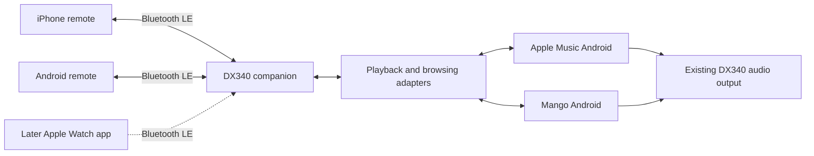

# DX340 Bluetooth Remote Implementation Plan

Prepared 28 October 2026 for an iPhone and Android remote, a DX340 companion, and a later Apple Watch extension.

Build a Bluetooth Low Energy remote that leaves music playback on the DX340. Support Apple Music downloads and the Android version of Mango Player, preserving Mango wherever its interfaces allow. Full album, playlist and song browsing remains a project requirement. A release with transport controls alone is an intermediate result, not completion of the full request.

The project is feasible to investigate using standard mobile APIs. Its complete feature set depends on tests on the actual DX340: BLE hosting, background operation, Mango integration and Apple Music browsing. Those tests precede a polished product. No app or hardware capability below is described as verified merely because an API exists.

## 1 User requirements and device baseline

| Requirement | Planned behavior | Evidence required before calling it supported |
| --- | --- | --- |
| Control from iPhone | Native app connects directly to DX340 | Installed iPhone build operates actual DX340 |
| Control from Android phone | Native app uses the same protocol | Installed Android remote operates actual DX340 |
| No Wi-Fi on the street | No hotspot, LAN or cloud dependency during control | Wi-Fi off on both endpoints, cellular data off on controller |
| Music stays on DX340 | Existing playback app continues using DX340 output | Playback continues when controller disconnects |
| Apple Music downloads | Control the already installed Apple Music app | Offline tests with downloaded tracks |
| Local FLAC and WAV | Preserve Mango Player if possible | Mango transport and play-selected-item tests |
| Browse albums and playlists | Select arbitrary available items on the phone | Selection starts the correct track on DX340 |
| Player remains in bag | Controls work after normal screen sleep | Physical one-hour walk and long pause tests |
| Apple Watch | Later native extension, basic controls first | Independent Watch hardware test |

Known inputs: the user has Mac access, reports iOS 27.2, and reports Android 13 build 1.09.851. Provisionally treat the latter as the DX340 build, consistent with iBasso's Android 13 V1.09 firmware family. Confirm it from the device before development; do not assume it identifies the separate Android phone. Record exact hardware models, OS builds, Apple Music version and Mango version in the test inventory. The official firmware listing is a reference, not an instruction to update firmware. [iBasso firmware](https://ibasso.com/?p=3694)

Use the DX340 in Android mode, with Mango's Android app. The companion will not run in standalone Pure Mango OS. Do not root the DX340 or modify its firmware as part of the baseline plan.

Initial proposed compatibility range: iOS 17 or newer, with iOS 27.2 as the user's acceptance device; Android 12 or newer for the remote, subject to identifying the actual phone; Android 13 build 1.09.851 on DX340. Compile and target SDK choices must satisfy release requirements at build time. A proposed range is not a tested-device claim.

## 2 What the HiBy experiment established

The user observed that their iPhone discovers the DX340 through a Wi-Fi entry in HiBy Music and loses control without Wi-Fi. Their installed iPhone app offers no Bluetooth permission entry. That establishes the tested path uses Wi-Fi and fails the requirement. It does not establish that iPhone cannot communicate with a custom DX340 BLE service.

The custom apps must demonstrate their own connection early. They will not depend on HiByLink, HiByCast or an undocumented promise of compatibility with those products.

## 3 Recommended architecture

User-selected revision, 28 October 2026: use a native Kotlin host on DX340 and a shared Flutter/Dart phone interface for Android and iPhone. Retain native Kotlin BLE/foreground-service and Swift CoreBluetooth/restoration underneath the shared UI. Keep existing native phone projects as parity references until migration is verified. Share a versioned protocol, examples, test fixtures and capability definitions. Keep music-app adapters on the DX340 so both controllers receive the same features.



The DX340 normally acts as a BLE peripheral and GATT server. The phones act as BLE centrals and GATT clients. BLE carries commands, state, text lists and small artwork transfers. It carries no music audio. The iPhone uses Core Bluetooth; the Android devices use native Bluetooth APIs. [Apple Core Bluetooth](https://developer.apple.com/documentation/corebluetooth/)

| Component | Technology and responsibility |
| --- | --- |
| DX340 companion | Kotlin, coroutines, Android Bluetooth APIs, media-session adapters and a foreground service |
| Android remote | Shared Flutter UI; Kotlin native BLE/service and local metadata cache |
| iPhone remote | Shared Flutter UI; Swift CoreBluetooth/restoration and local metadata cache |
| Watch extension | SwiftUI and Core Bluetooth, after phone milestones |
| Protocol | Shared specification, JSON schemas and Kotlin/Swift conformance fixtures |
| Persistent state | Android Room or simple structured storage; iOS local persistence; platform secure storage for credentials |

Produce separate Android host and controller build variants with shared modules. The DX340 variant requests host permissions; the phone variant does not need notification access to other apps. Product names and application identifiers can be chosen before signing the first beta.

The shared UI uses versioned platform channels to the existing native Bluetooth/lifecycle components. This reduces duplicated phone presentation work; it does not establish radio stability or remove physical acceptance gates. The future Watch app remains native.

## 4 Feasibility gates before committing to the full feature set

### Gate A BLE connection on the real DX340

Install a diagnostic APK that checks BLE support, advertiser availability and GATT server creation. Advertise a dedicated service UUID. Build minimal iPhone and Android clients that connect, exchange an authenticated test message and receive a counter update.

Test both controllers separately with Wi-Fi off and no internet. Test screen sleep and a 30-minute connection before proceeding. Android exposes an advertiser capability check, but a successful end-to-end test is the authority. [Android advertiser API](https://developer.android.com/reference/android/bluetooth/BluetoothAdapter#getBluetoothLeAdvertiser())

If hosting fails, inspect error codes and test firmware behavior without changing firmware. A reversed topology, with DX340 central and phone peripheral, is a research fallback; it requires another real iPhone background test and complicates direct Watch support. It must not silently replace the preferred architecture. If neither topology works reliably, the proposed stock-device architecture is blocked and needs an explicit design decision.

### Gate B Playback sessions and volume

With user-granted notification access, enumerate active media sessions using APIs available on Android 13. For Apple Music and Mango separately, record package, session lifecycle, advertised actions, metadata, queue information and volume behavior. Use MediaSessionManager.getActiveSessions rather than newer APIs unavailable on Android 13. Android permits active-session access through an enabled notification listener. [MediaSessionManager](https://developer.android.com/reference/android/media/session/MediaSessionManager)

Test play, pause, next, previous, supported seeking, supported shuffle/repeat and explicit source selection. Test after a long pause, after screen sleep, with both apps recently used, and after the source app is stopped. Test music resumption and cold launch separately. Record unsupported actions instead of presenting working controls for them.

For volume, begin at a low listening level. Confirm whether session volume or AudioManager affects the actual DX340 output. Check hardware-wheel changes, maximum/minimum, and the active amp configuration. Do not use hidden APIs or assume a reported system volume equals amplifier volume.

### Gate C Browsing and selecting a track

Inspect exported MediaBrowserService or supported Media3 interfaces for both music apps. Attempt a legitimate client connection, browse returned roots, and play returned media IDs. An app may refuse a client or expose controls without a browse tree. Do not spoof Android Auto's identity or assume its integration is available to our app. [Android browser access model](https://developer.android.com/media/legacy/audio/mediabrowserservice)

For Apple Music, the decisive test is browsing and starting a downloaded song that is not already in the current queue while fully offline. For Mango, it is browsing and starting a selected FLAC/WAV file while Mango remains the playback engine.

### Gate D Background and restart behavior

Test host sleep, phone lock, controller backgrounding, radio toggles, range loss, process termination and device restart. Distinguish recoverable suspension from a force-stop or reboot that needs user action. No app can command a DX340 that has fully powered off. Do not promise remote power-on.

Deliver a capability report with one row per source, action and state, including exact versions and logs. Gates A through D determine supported behavior; they do not remove the original browsing requirement.

## 5 DX340 companion implementation

Keep the host independent of the remote UI. Use these modules:

| Module | Responsibilities |
| --- | --- |
| BleHost | Advertising, GATT service, connection events, framing and transport limits |
| SessionRegistry | Discover eligible playback sessions, observe changes and maintain source identities |
| PlaybackRouter | Route a command to the selected source and serialize mutations |
| SourceAdapter | Common contract for state, commands, browse, queue and artwork |
| AuthorizationStore | Approved controllers, revocation and authenticated sessions |
| LibraryRepository | Metadata cache and revisions for exposed libraries |
| HostService | Foreground lifecycle, status notification and recovery |
| Diagnostics | Local bounded logs and user-initiated export |

Keep host lifecycle states explicit: stopped, permission required, advertising, authenticating, ready, reconnecting and error. Playback state is separate: paused, playing, buffering, stopped or unknown. BLE connected does not necessarily mean a music source is ready.

The setup wizard requests Nearby Devices access and explains notification access. It offers start/stop remote service, source selection, approved-device management and a diagnostic screen. The host must not request the user's Apple ID credentials. Apple Music remains signed in through its own app.

Selecting a source changes the control target. When starting another source, first establish that its session can accept the operation, then pause the previous source and confirm that transition before starting the selected source. If the handoff fails, report it instead of allowing unexpected overlap. Background app launch is a separately tested capability; the baseline may require opening each source once on DX340 after a reboot.

## 6 Playback and browsing adapters

### Apple Music adapter

Phase one uses the existing Apple Music media session. Read metadata and send only supported transport commands. The controller must display explicit play or pause operations, not depend on a toggle that can be replayed incorrectly.

Phase two uses a supported exported browse interface if Gate C succeeds. Keep opaque media IDs scoped to the source and library revision. Show only an offline-download filter if the interface provides trustworthy availability data. Verify that selection does not fall back to streaming.

Do not index Apple Music's protected private download directory. A catalog ID, cached iPhone library or MusicKit login does not itself establish access to another app's existing offline downloads. Preserve Apple's installed app as the playback engine in the baseline design.

If direct browsing fails, investigate a separate optional UI-assisted adapter. It would transmit structured accessible labels and user-selected navigation actions, not a continuous screen video over BLE. Test whether Apple Music exposes its downloaded-library interface, whether the screen must wake, and whether selection remains reliable after app updates. Avoid coordinate-based blind taps. Stop on an unexpected screen and report it.

Accessibility is a research branch, not a guaranteed route to full browsing. It may need a foreground, unlocked DX340 and would change the screen-off experience. Its use also affects Android distribution disclosures and review. [Android accessibility](https://developer.android.com/guide/topics/ui/accessibility/service), [Google Play accessibility policy](https://support.google.com/googleplay/android-developer/answer/10964491?hl=en)

If neither method succeeds, document that the full Apple Music browsing requirement remains unmet. A transport-only beta may still be useful, but it is not the complete requested product.

### Mango adapter

Preserve Mango as the first choice. Test its active media session, browse service and documented external playback mechanisms. If browse service access works, reuse its library and item identifiers. If the companion can scan the files but cannot ask Mango to play a specific item, that is incomplete integration.

Seek vendor documentation or an integration response only if needed; prepare a technical question for the user to send, or obtain explicit authorization before contacting anyone. Do not rely on undocumented internal intents as the production contract without a tested, versioned compatibility strategy.

If Mango cannot support arbitrary selection, present the tradeoff before implementation changes playback: retain Mango with limited remote commands; adopt another compatible player; or add a local playback module. Replacing Mango is not preapproved by this plan. A new playback module must separately prove output format, gapless behavior where required and sample-rate handling on the DX340.

### Local metadata and playlists

If a local index is needed, scan only user-selected storage roots using Android's appropriate storage APIs. Include removable microSD handling, persistent URI permissions and rescan behavior. Treat track IDs as opaque references, never remote-supplied arbitrary paths.

Support albums, artists, folders, tracks and existing exposed playlists. Handle WAV files with weak or absent metadata using filenames and folder browsing. Reuse source playlists where possible. M3U/M3U8 import can be a later enhancement; playlist editing is outside the user's initial browsing requirement. Never delete music as a side effect of changing the index.

## 7 Bluetooth protocol

Reserve one custom service with characteristics for protocol information, controller-to-host messages, and host-to-controller replies/events. Use the same contract on iPhone, Android and later Watch. Generate stable UUIDs once when implementing protocol version 1 and retain them in the specification.

Start with compact UTF-8 JSON for debuggability. Revisit binary encoding only after measuring a real transfer bottleneck. Include a protocol version, request ID, host session epoch, source ID, source epoch and message type. A new host process creates a new epoch so stale requests are rejected.

| Message family | Initial operations |
| --- | --- |
| Session | HELLO, AUTHORIZE, GET_CAPABILITIES, GET_STATE, SUBSCRIBE_STATE |
| Playback | SET_PLAYING, NEXT, PREVIOUS, SEEK, ADJUST_VOLUME, SET_SHUFFLE, SET_REPEAT, subject to source capabilities |
| Source | LIST_SOURCES, SELECT_SOURCE |
| Browse | BROWSE, SEARCH, PLAY_ITEM |
| Queue | GET_QUEUE, PLAY_QUEUE_ITEM, only where supported |
| Artwork | GET_ARTWORK with cache key and chunked response |
| Replies | ACCEPTED, RESULT, STATE_CHANGED, ERROR |

Every adapter advertises separate capabilities such as canBrowse, canSearch, canPlayItem, canSeek, canReadQueue, canResume and canAdjustVolume. No browsing service means browsing controls stay unavailable with a useful explanation. Source selection does not promise cold launch; expose that capability separately.

Respect the actual negotiated ATT capacity and iOS maximumWriteValueLength. Never hard-code a presumed 512-byte usable payload. Serialize platform BLE operations, split messages into bounded chunks, include message/chunk identifiers, and expire incomplete reassembly. Initial limits: 64 KiB per logical message, at most 50 browse items per page, and compressed artwork capped at 48 KiB. Large lists use cursors; artwork is lower priority than control commands.

Reduce the page count when metadata would exceed the message limit; never truncate a JSON object. Give each library response a revision and continuation cursor. Cache artwork by source-provided key or content hash and fetch it only when absent. A failed artwork transfer must not delay play/pause or invalidate the current track.

Requests need deduplication within an authenticated host session. A repeated NEXT with the same request ID must not skip twice. After reconnection, discard unsent controls and query fresh state; do not replay old next/previous/volume operations. If the host crashes during a command, report an unknown outcome rather than claiming exactly-once execution across crashes.

An ACCEPTED reply confirms validation and dispatch, not audible completion. Follow it with observed state or a timeout/unsupported result. The UI may briefly show a pending state, but must reconcile with the host.

Document error codes for denied authorization, unsupported capability, missing source, expired item, stale library, removed SD card, source not ready, permission revoked, malformed message and incompatible protocol.

Example command flow: the user chooses an album track; the controller sends PLAY_ITEM with its source, item ID, library revision and request ID; the host validates the authenticated session and current source capability; the adapter requests playback; the host replies with dispatch status and then observed playback state. If an item was removed or the adapter cannot select it, return a specific error. If the link drops, reconnect and read state before deciding whether another user command is needed.

## 8 Phone app experience

Keep the phone UI equivalent across platforms and separate connection state from playback state.

| Screen | Behavior |
| --- | --- |
| Setup | Explain that music stays on DX340; request Bluetooth access; discover and authorize DX340 |
| Now Playing | Artwork, title, artist, elapsed time, supported transport and volume |
| Library | Source picker, albums, artists, playlists, folders where supported, and search |
| Queue | Current queue and track selection when the source exposes them |
| Settings | Approved device, connection recovery, cached-library refresh and diagnostic export |

Use a small persistent playback bar while browsing. When disconnected, cached lists can remain visible with an offline status, but commands must not appear to have succeeded. A stale selection prompts refresh instead of playing an unrelated track.

Refresh and cache small library pages. Search should run on the DX340/source where possible so the entire collection need not transfer first. If an adapter exposes browsing but not search, search only a clearly identified cached scope or disable global search.

Disable unsupported controls individually. Provide usable text sizes, screen-reader labels and large playback targets. Keep engineering details in diagnostics, not in the everyday playback flow.

Initial setup may require handling the DX340 to authorize a phone and start a source app. Everyday supported controls should then work from the phone while the DX340 remains in the bag. When an app update or restart requires another setup action, explain exactly which action is necessary.

## 9 Background operation and permissions

On Android 12 and newer, request relevant BLUETOOTH_SCAN, BLUETOOTH_CONNECT and, on the host, BLUETOOTH_ADVERTISE permissions. Request notification access only on DX340 for cross-app media control. Request ordinary notifications where needed for the running service. Ask for local storage access only if the chosen adapter actually indexes files. [Android Bluetooth permissions](https://developer.android.com/develop/connectivity/bluetooth/bt-permissions)

Run the DX340 Bluetooth service as a foreground service while the user enables remote control. Use the connectedDevice service type and applicable declarations for the target SDK. Do not take a permanent wake lock by default; measure screen-off behavior before adding a narrowly scoped mechanism. Android closes Bluetooth connections if the hosting process is killed, and background starts have restrictions. Recovery must respect those restrictions. [Android foreground services](https://developer.android.com/develop/background-work/services/fgs/service-types), [background BLE](https://developer.android.com/develop/connectivity/bluetooth/ble/background)

On iPhone, provide NSBluetoothAlwaysUsageDescription, use the bluetooth-central background mode for the connection, scan by service UUID, and implement state preservation/restoration. Background support does not guarantee an immortal process or uninterrupted connection. Show reconnection when returning to the app and document recovery after a deliberate force-quit. Do not rely on pretending to play audio on the iPhone to stay alive. [Apple Bluetooth permission](https://developer.apple.com/documentation/bundleresources/information-property-list/nsbluetoothalwaysusagedescription), [Apple background behavior](https://developer.apple.com/library/archive/documentation/NetworkingInternetWeb/Conceptual/CoreBluetooth_concepts/CoreBluetoothBackgroundProcessingForIOSApps/PerformingTasksWhileYourAppIsInTheBackground.html)

For iOS 27.2, record the exact installed build and use a supporting Xcode version. Determine whether any newer behavior improves reconnect performance during testing; do not make a new OS feature a requirement for the initial shared protocol.

### Apple Watch extension

Use a native watchOS app with a proposed minimum of watchOS 10, subject to the user's actual Watch. Reuse Swift protocol models and the BLE client where compatible. Start with a foreground connection when the user opens the app, the current track, explicit play/pause, next/previous and verified volume controls. Add a complication that opens the remote; label cached track information as stale when it has not refreshed. Do not assume Apple's standard Now Playing screen automatically controls DX340.

Prefer a direct Watch-to-DX340 BLE path so opening the iPhone app is unnecessary. Authorize the Watch as its own controller. Under the initial single-controller policy, opening the Watch remote requests a handoff; test whether a second temporary connection is possible or whether the current phone connection must release first. A direct connection that cannot reliably acquire control without handling DX340 fails the intended Watch experience.

Use watchOS Bluetooth background support within its execution limits. Do not send continuous progress updates as time-sensitive alerts to keep the app alive. Refresh on foreground entry and reconcile after wrist-down suspension or range loss. Background updates are best effort. [Apple Watch background tasks](https://developer.apple.com/documentation/watchkit/using-background-tasks)

If direct operation fails, evaluate an explicit iPhone relay using Watch Connectivity. That route depends on the iPhone app's availability and reachability; it must be tested with Wi-Fi off and presented as a dependent mode, not equivalent to direct operation. Watch testing must cover opening from a complication, 20 command sequences, a 30-minute wrist-down pause, phone-to-Watch handoff, range recovery and battery use. Full Watch library browsing is a later enhancement; full browsing on both phones stays in the core scope.

## 10 Pairing and controller ownership

Require a user-initiated pairing window on DX340 and visible authorization of a new controller. Use authenticated encrypted BLE bonding where the devices support it, with persistent authorized controller identities. Do not trust the Bluetooth display name or a changing MAC address as identity.

Verify the actual pairing security properties during Gate A. If operating-system bonding is insufficient, select an established authenticated session mechanism using maintained platform cryptographic libraries before production; do not invent a cipher or treat a short reusable PIN as encryption. Bound connection attempts and message sizes. Store credentials in platform secure storage and provide revoke/forget controls.

Initially allow one active controlling session. A previously approved second phone can request control and perform a visible handoff without requiring repeated authorization on DX340. Do not promise simultaneous iPhone, Android and Watch connections before measuring host limits. Read-only connections and multiple controllers are later extensions.

Keep playback going when a controller disconnects. Reconnection restores observation first. It must not change volume or playback until the user issues a new command.

## 11 Audio quality and source behavior

With the control bridge, the existing music app remains responsible for decoding and DX340 output. Confirm in tests that connecting, browsing, pairing or receiving artwork does not change audio routing, gain, EQ or the selected output. Bluetooth control must not activate Bluetooth DAC/receiver mode or stream phone audio into DX340.

Compare source playback with the companion off and on using the same test tracks, output and volume. Record any dropouts or interference. Test a representative high-resolution FLAC and WAV set and Apple Music downloads. A sample-rate display is useful observation but not proof of bit-perfect output. Do not claim bit-perfect playback without appropriate independent measurement.

If a new local playback engine is proposed, treat it as a separate audio subsystem with its own validation. It may alter decoding, resampling and gapless behavior; that tradeoff requires a decision before replacing Mango.

## 12 Test plan and proposed acceptance targets

All numeric thresholds here are proposed engineering targets, not measured results. Record commands using the observed playback/session state and audio checks where relevant, not only successful BLE writes.

| Test | Procedure | Proposed pass condition |
| --- | --- | --- |
| T01 Offline connection | Disable Wi-Fi in device Settings and disable controller cellular data; connect each phone | Real BLE session and successful command exchange without network |
| T02 Discovery | Repeat discovery ten times at normal bag distance | At least nine connections within ten seconds; failures explained |
| T03 Basic control | At least 100 deliberate commands per source and phone | At least 99 percent confirmed, no duplicate skips or wrong-source commands |
| T04 Responsiveness | Measure transport acknowledgement and observed state separately | ACK p95 below 500 ms; state p95 below 1.5 seconds for local available tracks |
| T05 Screen off | Let DX340 sleep; pause for 30 minutes; resume from phone | No DX340 handling for supported session controls |
| T06 Range recovery | Leave range and return ten times | Reconnect within 15 seconds after app is foreground and device is available, without replaying stale commands |
| T07 Apple Music browse | Select 20 downloaded tracks across at least five albums and two playlists, including outside current queue | Correct track starts offline every time; direct or UI-assisted path identified |
| T08 Mango browse | Select at least 20 FLAC/WAV files across albums, folders and exposed playlists | Correct track starts through Mango every time |
| T09 Source switching | Alternate sources, pause one and control the other | Only selected source receives commands; no unwanted overlap |
| T10 Volume | Compare remote controls with wheel and actual output at low levels | Correct bounded changes; no unexplained jump on reconnect |
| T11 Library changes | Add/remove files, rescan, remove/reinsert SD card | Stale IDs rejected or refreshed; original files preserved |
| T12 Interruptions | Phone call, Bluetooth toggle, revoked permission, app backgrounding and host restart | Honest status, bounded recovery and clear required user action |
| T13 Battery | Matched two-hour runs with companion off/on, repeated three times; record relevant DX340 battery readings | Initial goal: no more than five percentage points additional drain per two hours; refine after baseline |
| T14 Walking | One hour with DX340 in actual bag and both phone platforms tested separately | Supported controls reliable, no unexpected playback interruption |
| T15 Authorization | Attempt unapproved connection and revoked-controller reconnection | No metadata/control access before authorization; revocation enforced |
| T16 Protocol faults | Duplicate, delayed, truncated and oversized messages; disconnect during transfer | No crash, duplicate playback mutation or unbounded allocation |
| T17 Installation | Fresh install, upgrade and credential persistence | Setup succeeds and upgrades preserve intended pairing/state |
| T18 Watch | Later physical Watch test, wrist-down and out-of-range cases | Supported Watch commands work without an internet connection |

Use unit tests for protocol framing, deduplication, stale IDs, adapter routing and cache revisions. Use shared Kotlin/Swift fixtures for identical protocol interpretation. Use instrumented tests for source adapters and lifecycle behavior. Emulators and simulators do not establish radio, audio or actual Mango/Apple Music compatibility; use physical hardware for those claims.

Library performance tests should use the user's actual collection size once known, plus a synthetic metadata collection of at least 10,000 tracks. Initial target: first cached page under 500 ms and first uncached page under three seconds, measured separately from source scan time. Source limitations may require a revised documented target, not an unexplained omission.

## 13 Implementation stages and deliverables

| Stage | Work and dependencies | Reviewable deliverable | Rough effort |
| --- | --- | --- | --- |
| P0 Device inventory | Confirm builds, app versions, local collection, Mac/Xcode and signing | Baseline inventory and target device matrix | 1 to 2 developer days |
| P1 Bluetooth proof | Gate A on DX340, iPhone and Android, with authorization feasibility | Diagnostic APK, minimal controllers, offline connection evidence | 4 to 7 days |
| P2 Source investigation | Gates B and C; start after minimal host works | Action, browse, queue, volume and startup capability report for both sources | 3 to 5 days |
| P3 Host foundation | Protocol version 1, permissions, routing, service and state recovery | Installable host with documented protocol and fixtures | 5 to 8 days |
| P4 Android remote | Pairing, controls, metadata, source state and recovery | Usable Android controller beta | 4 to 7 days |
| P5 iPhone remote | Equivalent controls, permissions, lifecycle and restoration | Usable signed iPhone beta | 5 to 8 days |
| P6 Local browsing | Implement Mango integration if supported; pagination, files and cache | Browse/select local tracks from both phones, with audio engine identified | 7 to 12 days |
| P7 Apple Music browsing | Implement a successful direct interface, conditional on P2 | Offline album/playlist selection from both phones | 4 to 8 days if interface works |
| P8 Reliability and release | Walking, faults, battery, install/upgrade and documentation | Tested beta packages, compatibility matrix and user guide | 5 to 8 days |
| P9 Apple Watch | Depends on stable host and shared protocol | Native Watch controls and hardware evidence | 5 to 10 days |

P0 through P6 plus P8 total 34 to 57 developer days, assuming Mango integration works. Direct Apple Music browsing adds 4 to 8 days, making the phone scope 38 to 65 days. Watch adds 5 to 10 days. These are planning estimates for an experienced developer, including debugging and device testing, not promised calendar dates or AI execution times.

Allow a separate 8 to 15 day research/integration budget for UI-assisted Apple Music browsing if direct access fails, with no guarantee of satisfying screen-off operation. A new local playback engine could add 8 to 15 days and separate audio verification. Re-estimate after P2. Do not spend the full implementation budget before the feasibility report.

P4 and P5 can share a frozen protocol and progress independently after P3. Begin P2 research before polishing either controller. Integrate browsing into both phone apps as soon as an adapter becomes available. Testing on both platforms remains continuous rather than waiting until final release.

## 14 Development environment and repository

Use one repository with independently buildable Android and Apple projects. The user has Mac access; record the Mac's macOS version and install an Xcode release that supports the actual iOS 27.2 device. Keep Android Studio, a compatible JDK and SDK toolchains pinned through project configuration. [Xcode system requirements](https://developer.apple.com/xcode/system-requirements)

Suggested layout:

```text
android/
  host-app/
  remote-app/
  core-protocol/
  core-ble/
  source-adapters/
  library-cache/
apple/
  DXRemote/
  BLEClient/
  ProtocolModels/
  DXRemoteWatch/
protocol/
  specification.md
  schemas/
  fixtures/
docs/
  device-inventory.md
  capability-report.md
  compatibility-matrix.md
  installation.md
  test-results/
```

Create the Watch target when that phase starts. Do not add backend hosting, a web dashboard, accounts or a cloud synchronization service to the baseline. Store signing keys outside source control. Run Android checks on a standard build runner and Apple builds on a Mac; physical device acceptance tests remain separately recorded.

## 15 Installation and distribution

For initial DX340 and Android testing, provide signed APKs, version information, hashes and installation instructions. Retain the same signing identity for updates. Document any Android restriction encountered when enabling notification access for a sideloaded app, using the actual firmware's settings rather than a guessed universal path.

For iPhone development, use Xcode device deployment with appropriate signing. For a convenient ongoing beta, use TestFlight with the required developer-account setup. TestFlight builds expire after 90 days, so it is not a permanent install-and-forget distribution solution. Plan build renewal or a suitable long-term release route. [Apple TestFlight](https://developer.apple.com/help/app-store-connect/test-a-beta-version/testflight-overview/)

Public App Store or Google Play distribution is a separate release step after the private beta works. Prepare Bluetooth purpose strings, privacy details and accurate source compatibility claims. If accessibility is included, assess its declarations and review requirements against the actual functionality. Store approval is not guaranteed by technical success.

Installing or updating apps can require internet beforehand. Everyday playback control and library browsing of already available content must not require an internet connection. Preserve Apple Music's own download and subscription requirements; the remote does not replace its authorization system.

## 16 Maintenance and failure recovery

Record a tested combination of DX340 firmware, Apple Music version, Mango version, remote OS and app version. On updates, rerun relevant source and lifecycle tests. If a source integration breaks, downgrade that adapter's capabilities visibly while keeping verified functions available. Never silently switch playback engines.

Keep a bounded local event log with timestamps, request IDs, source IDs, errors and connection transitions. Do not include access credentials or unnecessary notification contents. Diagnostic export is user initiated. Distinguish BLE failure, denied authorization, missing source session and unsupported browse access in support messages.

App uninstall removes its permissions and local cache; revoking a phone on DX340 prevents later control. Stopping the companion leaves source playback intact. Re-pairing should not require deleting music or resetting the DX340. Keep a tested previous APK/build and documented rollback limits for schema changes.

## 17 Decisions still needed before implementation

| Item | Current plan | When to resolve |
| --- | --- | --- |
| DX340 baseline | Provisionally Android 13 build 1.09.851 | P0 inventory |
| iPhone | iOS 27.2 reported; hardware model and exact build unknown | P0 inventory |
| Android remote | Hardware model and OS unknown | Before selecting minimum remote OS |
| Mac | Available; macOS and Xcode not yet inventoried | Before iPhone device build |
| Local player | Preserve Mango Android as first choice | P2 capability gate |
| Library scale | Track count, SD card layout, playlist formats unknown | Before P6 performance fixtures |
| Headphone output | Wired/other routing and amp configuration not recorded | Before volume/audio tests |
| Watch | Retained in roadmap; model/watchOS unknown | Before P9 |
| Distribution | Private beta first; long-term route to choose | Before beta signing/account setup |
| Browse fallback | No change from Mango or screen-off behavior authorized by this plan | If P2 finds unsupported interfaces |

These details refine implementation and testing. They do not prevent completing the design now. The next concrete deliverable after this plan is P0 inventory followed by P1 diagnostic applications, with a real iPhone connection tested early.

## 18 Definition of completion

The phone implementation is complete only when both installed remote apps control the actual DX340 over Bluetooth with Wi-Fi off, support the agreed playback actions, and browse/select the requested local and downloaded Apple Music content through verified integrations. Mango remains the local playback engine unless the user accepts a specific alternative. The DX340 stays in the bag for the agreed everyday workflow, and source playback survives controller disconnection.

Completion evidence includes signed installable builds, exact device/version inventory, a per-source capability report, passing acceptance results, documented setup/recovery, and the protocol specification. Unsupported Apple Music browsing or an unapproved replacement of Mango leaves the full scope incomplete even if the transport-only beta is useful. Apple Watch has a separate completion milestone after the phone implementation.

This document completes implementation planning. It does not claim that any custom application, hardware test or source integration has already been built or passed.
